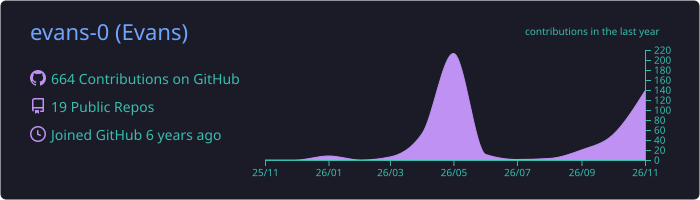
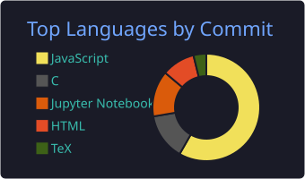

 

---

### 👨‍💻 About Me

M.Sc. candidate in **Data Analytics & Computational Sciences** at Digital University Kerala, working at the intersection of **Quantitative Finance** and **Production Data Engineering**. I build alpha-generating financial models and ship end-to-end, hardened data platforms—from database architecture to live cloud deployments.

- 🔭 **Currently:** Scaling and hardening a real-time IoT cold-chain telemetry platform on AWS & PostgreSQL.
- 📫 **Open to:** Quantitative research, FinTech, data engineering, and algorithmic trading collaborations.

---

### 💼 Experience

| Role & Organization | Key Contributions |
| :--- | :--- |
| **Research & Development Intern**   *Digital University Kerala* | <ul><li>Architected and deployed a production **IoT Cold-Chain Monitoring Platform**, migrating legacy telemetry from Google Sheets to **AWS RDS (PostgreSQL)** for real-time fleet tracking.</li><li>Engineered fault-tolerant data ingestion with local fallback queuing to prevent sensor data loss during database timeouts.</li><li>Hardened the Linux/Nginx/Gunicorn stack with automated intrusion blocking (**Fail2Ban** multi-jail policies, rate limiting, and `444` scanner drops) and custom live ops monitoring.</li></ul> |
| **Research Consultant**   *WorldQuant Brain (Freelance, Remote)* | <ul><li>Design, backtest, and iterate on systematic alpha signals and factor models to capture market inefficiencies.</li><li>Optimize portfolio risk metrics—balancing Sharpe ratio, drawdown, and turnover—using quantitative finance frameworks.</li></ul> |

---

### 📂 Featured Projects

| Project | Description | Core Stack |
| :--- | :--- | :--- |
| **Real-Time IoT Cold-Chain Platform** | End-to-end telemetry dashboard monitoring live cold-chain assets, alerts, and device health. Built with resilient ingestion queuing, PostgreSQL storage, and hardened Nginx/Fail2Ban cloud deployment. | `Python` `PostgreSQL` `AWS` `Nginx` `Gunicorn` `Fail2Ban` |
| **Indian Stock Market Portfolio Optimization** | Quantitative optimization model computing the efficient frontier for Indian equities, implementing Sharpe Ratio maximization to identify optimal risk-adjusted asset allocations. | `Python` `Pandas` `NumPy` |
| **Financial Performance Dashboard** | Interactive executive BI dashboard tracking Gross Revenue, Profit, Discount, and Profit Margin with dynamic regional drill-downs. | `Tableau` `Data Modeling` |

---

### 🛠️ Technical Arsenal

| Domain | Technologies |
| :--- | :--- |
| **Languages** | Python, SQL (PostgreSQL, MySQL), R, C/C++, HTML |
| **Data Science & Quant** | Pandas, NumPy, Matplotlib, Portfolio Optimization, Alpha Research |
| **Cloud & DevOps** | AWS (EC2, RDS), Linux, Nginx, Gunicorn, Fail2Ban, Google Cloud Platform |
| **BI & Visualization** | Tableau, Power BI, IBM Cognos Analytics, BigQuery |
| **Tools** | Git, GitHub, tmux, LaTeX |

---

### 📜 Certifications & Achievements

- **Certifications:** Google Cloud Career Launchpad (Data Analytics) · CFI Business Intelligence & Data Analyst (BIDA) · Duke University Behavioral Finance · IBM SQL, ETL & BI Fundamentals
- **Achievements:** 1st Place in 3+ intercollegiate physics quizzes, including the **Madame Marie Curie Trophy (2024)** and **Battle of Brainiez (2024)**

---

### 📊 GitHub Analytics

  

 

**Contribution History**
 

